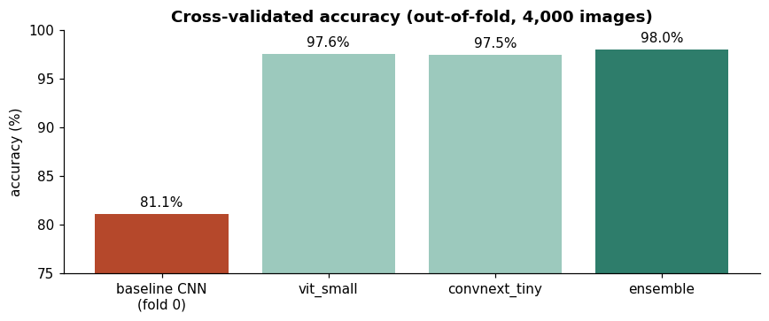
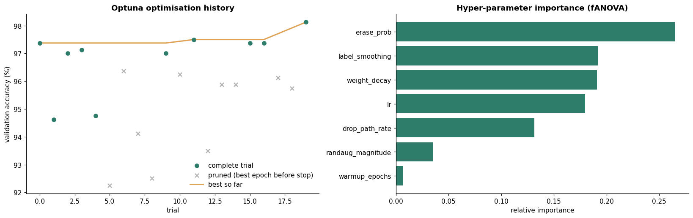
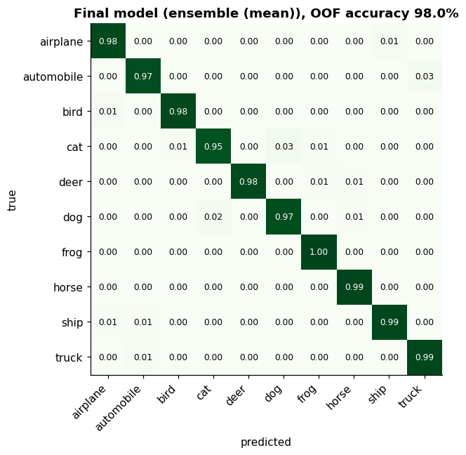

# CIFAR-10 Image Classification with PyTorch (DSA 4050-XA CAT 2)

Classifying 32×32 colour images into 10 classes (airplane, automobile, bird, cat, deer, dog, frog, horse, ship, truck) with **PyTorch**. The model trains on only **4,000 labelled images** (400 per class) and predicts **46,000** unlabelled test images.

**DSA 4050-XA Deep Learning · United States International University–Africa (Fall 2026)**  
Selmah Tzindori (669602) · Lecturer: Dr. Alex Wambua

## Result

**98.05% cross-validated accuracy** (5-fold out-of-fold, 4,000 images), from an ensemble of 10 fine-tuned, ImageNet-pretrained networks: 5 × ViT-Small and 5 × ConvNeXt-Tiny.

| Model | Accuracy | Measured on |
|---|---|---|
| Random guessing | 10.0% | 10 balanced classes |
| Small ResNet trained from scratch (baseline) | 81.1% | validation fold 0 |
| ViT-Small pretrained, default settings | 96.4% | validation fold 0 |
| ViT-Small, Optuna-tuned | 97.6% | 5-fold out-of-fold |
| ConvNeXt-Tiny, same settings | 97.5% | 5-fold out-of-fold |
| **Ensemble ViT + ConvNeXt, flip TTA** | **98.05%** | **5-fold out-of-fold** |

Predictions: [`outputs/submission/Test_predictions.csv`](outputs/submission/Test_predictions.csv) (same format as `Test.csv`, `label` filled with class names).



## CAT requirements and where they are met

| Requirement | Where |
|---|---|
| 1. Data loader that subclasses `torch.utils.data.Dataset` | `CIFARCSVDataset` in [`src/cat2_utils.py`](src/cat2_utils.py), demonstrated in notebooks 01 and 05 |
| 2. Data augmentation for training data | `build_transforms()`: random crop, horizontal flip, RandAugment, random erasing (notebooks 01, 05) |
| 3. Appropriate algorithm for hyper-parameter selection | **Optuna TPE** (Bayesian optimisation) with **median pruning**, 20 trials (notebook 03) |
| 4. Accuracy + description | 5-fold cross-validation, ensemble and TTA (notebook 04); full write-up in notebook 05 |

## Method in brief

1. **Data (01):** integrity checks, class balance (400 per class), pixel statistics (train ≈ test), and 5 stratified folds of 800 images.
2. **Baseline (02):** a 2.8M-parameter ResNet trained from scratch reaches 81.1% but overfits (96% training accuracy).
3. **Transfer learning + search (03):**
   - Three ImageNet-pretrained backbones were screened at 224×224 (images upscaled). ViT-Small 96.4% ≈ ConvNeXt-Tiny 96.3% ≫ ResNet-50 86.0%.
   - Optuna's TPE sampler then tuned 7 hyper-parameters of ViT-Small: learning rate, weight decay, label smoothing, RandAugment magnitude, erasing probability, drop-path and warm-up.
   - Best trial: 98.1% on fold 0.
4. **Final training (04):**
   - Both architectures were trained on all 5 folds with the tuned settings, keeping last-epoch weights.
   - Predictions use the average of the image and its horizontal flip (TTA), and the two architectures' probabilities are averaged.
   - The ensemble removes about 18% of the single-model errors.
5. **Report and submission (05):** the full description, 8 automatic checks of the CSV against `Test.csv`, and a visual check of the test predictions.





All classes reach at least 95% recall. Cat (95.2%) is the hardest; the main confusions are cat↔dog and automobile→truck.

## Notebooks (run in order on Google Colab, T4 GPU)

| # | Notebook | Purpose | GPU time |
|---|---|---|---|
| 00 | [`00_project_setup`](notebooks/00_project_setup.ipynb) | Drive folders, helper module, libraries, GPU check, data unzip | – |
| 01 | [`01_data_exploration`](notebooks/01_data_exploration.ipynb) | Data checks, images, statistics, Dataset class, augmentation, folds | – |
| 02 | [`02_baseline_cnn`](notebooks/02_baseline_cnn.ipynb) | Small ResNet trained from scratch (reference) | ~6 min |
| 03 | [`03_hyperparameter_search`](notebooks/03_hyperparameter_search.ipynb) | Backbone screening + Optuna TPE search | ~45 min |
| 04 | [`04_final_training`](notebooks/04_final_training.ipynb) | 5-fold training of 2 models, ensemble, TTA, predictions | ~50 min |
| 05 | [`05_submission_and_report`](notebooks/05_submission_and_report.ipynb) | **Final report**, submission checks, visual check | CPU |

## Repository structure

```
├── notebooks/            00–05, run in order (outputs included)
├── src/cat2_utils.py     shared code: paths, Dataset class, transforms, training, prediction
├── outputs/
│   ├── figures/          key figures used in this README
│   └── submission/       Test_predictions.csv
├── data/                 (not tracked) data comes from the lecturer's Google Drive folder
└── models/               (not tracked) fold models and Optuna study live on Google Drive
```

## Data and reproducibility

- **Data:** from the lecturer's shared Google Drive folder:
  - `train.zip` (50,000 PNGs named `<id>.png`)
  - `Train.csv` (4,000 labelled ids)
  - `Test.csv` (46,000 ids to predict)

  The data is not stored in this repo. In Colab, add the shared folder to *My Drive* as a shortcut and set `DATA_SOURCE` at the top of each notebook.
- **Outputs:** all results are written to the project folder on Google Drive (`DSA4050/cat2-image-classification`). Long steps save progress and resume after a Colab disconnect.
- **Seeds:** fixed (42). GPU runs can still differ by a few images.
- **Integrity:**
  - The only labels used are the 4,000 in `Train.csv`.
  - The only external resource is publicly available ImageNet-pretrained weights (`timm`).
  - The test images were used only for prediction.
- **Environment:** Python 3.13 · PyTorch 2.11 · torchvision 0.26 · timm 1.0 · Optuna 5.0 · scikit-learn 1.6.
